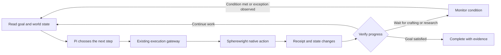

# Game Agent Goal Execution and Status Display

English · [简体中文](game-agent-design.zh-CN.md)

Updated 2026-11-11. The design baseline is CommandDeck `e2d75d11e3b84b4bc01a00ae776f8f5fc3e5361d` with pinned Pi `71023aec1546d6d677a65669c5665c0927ce0dd0`.

The game Agent works continuously toward a verifiable objective. Deck stores the goal, stages, facts, budgets and action evidence. Pi chooses the next step when a decision is needed, and Spherewright supplies native observations and actions. Deck's Current goal and Current action panels display that same task state.

This document records the discussed design direction. The goal controller, condition waiting, production verification and panel projection below remain planned work, with the implementation order in section 8. Section 1 describes the existing implementation. Milestone status remains in the [Roadmap](../ROADMAP.md).

## 1. Existing foundation and remaining work

The current game mode uses `createAgentSession()` to assemble models, sessions, events and the tool loop from the pinned Pi source. It supplies a game system prompt, an explicit tool set and an isolated task directory, and dynamically connects tools from the selected Spherewright MCP service. Development and game modes each assemble their own configuration and permissions. [Game Agent](../apps/desktop/game-agent.mjs)

The execution layer already maintains finite goal authorization, action scope, durable intent before dispatch, single submission, original-action reconciliation and unknown-result quarantine. General game tasks have source and synthetic desktop evidence. Evidence for the real research-enqueue workflow has its own scope. [Game execution session](../apps/desktop/spherewright-game-session.mjs) · [Action ledger](../apps/desktop/game-intent-ledger.mjs) · [Roadmap](../ROADMAP.md)

Today `startMcp()` invokes the planner once. Pi can call tools repeatedly within that run. When the planner returns, the host either reconciles unresolved actions or ends the round. A sustained objective still needs explicit stages, condition waiting, progress detection and production verification. A normal model stop indicates the end of that conversational round. [Task scheduling](../apps/desktop/game-tasks.mjs)

## 2. Responsibilities and customization points

| Layer | Responsibility |
| --- | --- |
| Pi | Provider calls, streaming, tool loops, session events, context processing and queued user input |
| Deck game task controller | Goals, stages, decision scheduling, wait conditions, budgets, progress detection and objective verification |
| Deck execution gateway and ledger | Authorization checks, native prepare integration, durable intent, sole submission, original receipts and recovery state |
| Spherewright | Game facts, recipe and technology catalogs, placement and material rules, normal native actions and final safety checks |
| Deck UI | Current goal, stage, action, reason, next step, verification progress and original-evidence navigation |
| Lab | Scenario inputs, version adoption, live acceptance and complete execution evidence |

The first iteration keeps the existing `createAgentSession()` integration and adds game-domain task logic in Deck. The Pi fork retains general Agent capabilities, with any missing general integration hooks handled separately. Game and development Agents can share the Pi foundation while selecting their own prompts, context, tools and task policies.

Pi already exposes request preparation, context transformation, tool hooks and turn finalization. When using its session layer, prefer the session extension interfaces and preserve its recording and scheduling behavior. [Pi Agent interfaces](../vendor/pi/packages/agent/src/types.ts) · [Session extensions](../vendor/pi/packages/coding-agent/docs/extensions.md)

| Customization | Reusable Pi interface | Integration requirement |
| --- | --- | --- |
| Briefing before each decision | `prepareRequest`, `transformContext`, or the session `context` extension | Preserve required tool-call/result pairing and attach provenance and freshness to facts |
| Stage tool set | Custom tools and `setActiveTools()` | Active tools remain bounded by host authorization |
| Tool feedback | `beforeToolCall`, `afterToolCall`, or `tool_call` and `tool_result` extensions | Preserve the meaning of native outcomes and durable receipts |
| Another decision turn | `finishTurn`, or session `turn_end` and `agent_before_settle` | Continue finitely according to progress, remaining work and budget |
| User goal changes | `steer()`, `followUp()` and host task commands | Handle queued messages and the stop of new submissions separately, while reconciling accepted actions |

## 3. Goals and runtime state

The following is a logical model. Implementation will define fields and migrations alongside the existing task ledger.

| Record | Information to preserve |
| --- | --- |
| Goal | User intent, goal revision, measurable completion conditions, world binding and observation scope |
| Stage | Current subgoal, prerequisites, completion predicates and unresolved gaps |
| Plan | Adopted strategy, next candidate action and reasons for changing the strategy |
| World facts | Source tool, session/version binding, capture tick, coverage and freshness |
| In-flight action | Original intent and action identity, phase, latest receipt and effects awaiting verification |
| Wait | Condition, observation cadence, deadline conditions and wake-up reason |
| Budget and authorization | Original task scope, cumulative consumption, remaining allowance and effective authorization state |
| Evidence | Observations, receipts and measurement windows supporting stage and goal predicates |

Stages advance according to actual resources, technology, locations and facilities. The model can propose strategy changes. The task controller preserves the adopted plan revision and its supporting facts.

Goal states such as Running, Waiting, Blocked, Paused and Completed are recorded separately from action states such as Planned, Preparing, Executing, Verifying, Completed, Failed and Awaiting reconciliation. A pause or cancellation request first freezes new submissions while keeping in-flight reconciliation visible.

The same task continues accumulating its budget across stages, model changes and context compaction. UI reload reads the original task. Application restart first restores the display, reconciles original actions and validates current context. Further execution follows the existing authorization lifecycle.

## 4. Sustained execution and condition waiting

The task controller decides when a model request is needed. The model selects research, production, construction or troubleshooting strategies. The execution gateway continues through the existing public MCP interface for fresh prepare, authorization checks, durable intent, sole commit and original-action reconciliation.

Crafting, research and production waits use bounded condition monitoring. During a normal wait, the program observes relevant facts. A satisfied condition, state change, user adjustment or timeout triggers the next decision. Observation uses the same managed connection and original task budget while retaining the single-writer constraint.

Continuation hooks such as `finishTurn` decide whether one further turn is needed. The task controller owns waiting. Progress predicates use changes in resources, technology, facilities, connections, power or actual production.

| Observed feedback | Handling |
| --- | --- |
| Missing materials or energy | Select replenishment, refueling, other work or a condition wait |
| Native placement prepare refused | Preserve the reason, refresh observations and choose another location or strategy |
| Crafting or research proceeding normally | Preserve the wait condition and track the original action or objective facts |
| Repeated failure with the same state and parameters | Adjust strategy within the remaining attempt budget, then report Blocked when it is exhausted |
| Accepted action with an uncertain outcome | Freeze new submissions, reconcile the original identity and retain quarantine state |
| Stale data, incomplete coverage or changed world binding | Refresh facts or establish a valid binding, with verification shown as pending |
| User pause or takeover | Freeze scheduling in the host, reconcile accepted actions, then display readiness to continue or hand over |

Physical player-input coordination retains the M0/M3 live-acceptance boundary. The goal panel's paused state describes task scheduling. Game-side input exclusion and simulation pause each require their own supported capability and evidence.

## 5. Context and game skills

Each decision uses four kinds of input.

- Stable rules contain the role, overall objective, tool-use principles and current authorization scope.
- The current briefing contains the stage, relevant inventory, facilities, power, logistics, recent changes and fact freshness.
- Working memory contains the adopted strategy, completion predicates, recent failures, in-flight actions and effects awaiting verification.
- Stage knowledge loads recipes, technology dependencies and relevant operating guidance on demand.

Context summaries reference persistent facts and original receipts. Older observations retain their timestamps and missing data remains unknown. Compaction can shorten model history while task storage maintains goals, budgets, original actions and evidence.

Start with composable skills for basic power, supplying a material, building a small production chain, diagnosing starvation and verifying throughput. Each skill describes prerequisites, relevant MCP capabilities, expected changes and failure handling. Material ratios derive from Spherewright's actual catalog, with execution conditions decided by native prepare.

Tools remain dynamically discovered from Spherewright. Each stage prioritizes relevant tools for the model while the host enforces the complete authorization scope. The program handles repetitive observations and action waiting, leaving strategy choices to the model.

## 6. Current goal and Current action panels

The execution controller and UI share one task state. Runtime produces a consistent display snapshot from durable goals and the original-action ledger, and the UI subscribes to snapshots and state events. Model-generated reasoning is attached to the corresponding plan or action as explanation.

| Panel field | Source | Display |
| --- | --- | --- |
| Current goal | Saved goal revision | User objective, measurable conditions and world alias |
| Current stage | Stage state and completion predicates | Current subgoal, completed stages and remaining gaps |
| Current action | Current plan, original action and receipts | Planned, preparing, executing, verifying or waiting state |
| Reason | Adopted strategy explanation and relevant facts | Why this step was chosen and which observations support it |
| Next step | Current plan and dependencies | Next candidate action and its prerequisites |
| Waiting or blocked reason | Condition monitor and error classification | What is awaited, deadline conditions and proposed handling |
| Verification progress | Objective verifier | Measured rate, measurement window, coverage and freshness |
| Evidence and controls | Original record references and host commands | Open receipts, pause further work, revise the goal and request takeover |

Goal progress prioritizes satisfied predicates, remaining gaps and actual measurements. When the number of stages can still change, show concrete status. Display an estimated completion time only when a reliable estimate exists.

Executing requires evidence of an accepted action. Completed requires the corresponding terminal result and necessary readback. When no action is active, show Waiting, Deciding or Idle. Missing or stale measurements show Pending verification and retain the time of the latest valid observation.

Opening an action reveals its plan, original receipts and related observations. Closing chat or reloading the UI continues to display the same task. A model change preserves goal/action ownership and refreshes world facts.

### Illustrative blue-matrix display

These are illustrative field values that may appear at different stages.

| Field | Example |
| --- | --- |
| Current goal | Establish a stable 60/min blue-matrix line in a new world |
| Current stage | Establish circuit-board supply |
| Current action | Wait for the current circuit-board crafting batch |
| Reason | Supply the research lab and remaining production facilities |
| Next step | Prepare lab construction when materials are available |
| Verification progress | Production rate awaiting measurement |

## 7. Completion and blue-matrix validation

The first validation uses a dedicated new world, Pi and the user-selected MiniMax-M3.1-Flash to exercise the complete goal loop. Sixty blue matrices per minute is the provisional acceptance target used in this discussion. The actual rate and sustained window must be explicitly stored when the task starts.

Completion requires the automatic supply chain, relevant facilities and connections, power and actual production evidence to satisfy the objective together. Measurement uses a declared game-time basis and observation scope, distinguishing production, designed capacity and inventory changes. Insufficient coverage keeps verification pending.

Record at least time to first matrix, sustained throughput, actual model/tool calls, resource consumption, human interventions and failure reasons. Lab records stage interruptions, original action outcomes and save coverage so behavior can be reproduced for the same version.

## 8. Implementation order and acceptance

| Step | Deliverable | Acceptance focus |
| --- | --- | --- |
| 1 | Durable goals, stages and Current goal/action snapshots | Retain the objective when a conversation ends, and display the same task and original actions after UI reload |
| 2 | Condition waiting, current briefings and bounded continuation | Observe only as needed while waiting, wake decisions on events, accumulate budgets and freeze new submissions promptly on pause |
| 3 | Production verifier and live blue-matrix run | Actual sustained production meets the objective, with original receipts, measurement windows and intervention records preserved |
| 4 | Skills and context policies informed by actual failures | Compare progress, cost and human intervention using the same acceptance criteria |

Changes primarily belong in the existing game tasks, Pi assembly, execution session, ledger and game panel. Concrete storage fields and migration are determined with step 1. [Task scheduling](../apps/desktop/game-tasks.mjs) · [Pi assembly](../apps/desktop/game-agent.mjs) · [Execution session](../apps/desktop/spherewright-game-session.mjs) · [Action ledger](../apps/desktop/game-intent-ledger.mjs) · [Game panel](../apps/renderer/src/game-tasks.tsx)

Targeted regressions cover an early model stop, condition satisfaction/timeout, repeated lack of progress, stale data, exhausted budgets, unknown original actions, and task ownership after UI reload, application restart or model changes. Retain the existing execution safety contract and declare the exact runtime version, world scope and measurement conditions for live validation.
