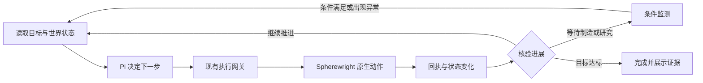

# 游戏 Agent 目标执行与状态展示

[English](game-agent-design.md) · 简体中文

更新于 2026-11-11。设计基线为 CommandDeck `e2d75d11e3b84b4bc01a00ae776f8f5fc3e5361d` 与固定 Pi `71023aec1546d6d677a65669c5665c0927ce0dd0`。

游戏 Agent 围绕一个可验证的目标持续工作。Deck 保存目标、阶段、事实、预算和动作证据，Pi 在需要决策时选择下一步，Spherewright 负责原生观察与动作执行。Deck 的“当前目标”和“当前行为”栏目直接展示这份任务状态。

目标控制器、条件等待、有限续接、产率验证器和“当前目标／当前行为”栏目现已实现，并通过源码与合成桌面验证。真实 MiniMax 也已在合成游戏服务上完成目标规划、一次制造和验收。独立新档的蓝糖实机产线仍待验证，实施与验收范围见第 8 节。里程碑状态继续由 [Roadmap](../ROADMAP.md) 维护。

## 1. 现有基础与缺口

当前游戏模式已通过 `createAgentSession()` 装配固定 Pi 源码中的模型、会话、事件与工具循环。它设置游戏系统提示词、显式工具集合和独立任务目录，动态接入选定 Spherewright MCP 的工具。开发模式和游戏模式分别装配自己的配置与权限。[游戏 Agent](../apps/desktop/game-agent.mjs)

现有执行层维护有限目标授权、操作范围、提交前持久化意图、单次提交、原动作核销和未知结果隔离。通用游戏任务已有源码与替身桌面验证，真实科研入队闭环的证据范围单独记录。[游戏执行会话](../apps/desktop/spherewright-game-session.mjs) · [动作账本](../apps/desktop/game-intent-ledger.mjs) · [Roadmap](../ROADMAP.md)

当前 `startMcp()` 为持续目标创建宿主控制器。Pi 会话在每轮正常结束后取得新的任务简报，依据目标完成情况、进展和剩余预算决定继续或结束。旧调用继续使用单轮语义。目标、阶段、条件和使用量以 version 1 元数据保存在现有 v3 游戏账本中，原动作记录沿用其原格式。[任务调度](../apps/desktop/game-tasks.mjs) · [目标控制器](../apps/desktop/game-goal.mjs) · [状态合同](../apps/desktop/game-goal-contract.mjs)

## 2. 职责与定制位置

| 层 | 负责的内容 |
| --- | --- |
| Pi | Provider 调用、流式响应、工具循环、会话事件、上下文处理和用户消息插入 |
| Deck 游戏任务控制器 | 目标、阶段、决策调度、等待条件、预算、进展判断与目标验收 |
| Deck 执行网关与账本 | 授权检查、原生预检接线、持久意图、唯一提交、原动作回执与恢复状态 |
| Spherewright | 游戏事实、配方与科技目录、放置和材料规则、正常原生动作及最终安全检查 |
| Deck 界面 | 当前目标、阶段、行为、原因、下一步、验收进度和原始证据入口 |
| Lab | 场景输入、版本采用、实机验收与完整运行证据 |

第一轮继续复用现有 `createAgentSession()` 集成，在 Deck 中补充游戏领域的任务逻辑。Pi fork 保持通用 Agent 能力，所需通用接口缺口再独立处理。游戏与开发两种 Agent 可以共享 Pi 底座，各自选择提示词、上下文、工具与任务策略。

现有 Pi 已提供请求准备、上下文变换、工具前后钩子和轮次收尾接口。采用会话层时，优先使用其扩展接口，并保留会话自身的记录与调度行为。[Pi Agent 接口](../vendor/pi/packages/agent/src/types.ts) · [会话扩展](../vendor/pi/packages/coding-agent/docs/extensions.md)

| 定制内容 | 可复用的 Pi 接口 | 接入要求 |
| --- | --- | --- |
| 每轮现场简报 | `prepareRequest`、`transformContext`，或会话 `context` 扩展 | 保留协议所需的工具调用与结果配对，事实带来源和时效 |
| 阶段工具集 | 自定义工具与 `setActiveTools()` | 工具激活范围始终受宿主授权约束 |
| 工具反馈 | `beforeToolCall`、`afterToolCall`，或 `tool_call`、`tool_result` 扩展 | 原生结果和持久回执保留其真实含义 |
| 下一轮决策 | `finishTurn`，或会话 `turn_end`、`agent_before_settle` | 依据进展、待办和剩余预算有限续接 |
| 用户调整目标 | `steer()`、`followUp()` 与宿主任务命令 | 消息插入与停止新提交分别处理，已受理动作继续核销 |

## 3. 目标与运行状态

下面是逻辑模型。实现时结合现有任务账本定义字段和迁移，字段名在该步骤确定。

| 内容 | 必须保存的信息 |
| --- | --- |
| 目标 | 用户意图、目标版本、量化完成条件、适用世界与观察范围 |
| 阶段 | 当前子目标、前置条件、完成谓词、待解决的缺口 |
| 计划 | 当前采用的方案、下一项候选行为、改变方案的原因 |
| 世界事实 | 来源工具、会话与版本绑定、捕获 tick、数据覆盖和新鲜度 |
| 在途动作 | 原意图、原动作标识、阶段、最近回执及待核验的变化 |
| 等待 | 等待条件、观察频率、截止条件和唤醒原因 |
| 预算与授权 | 原任务范围、累计消耗、剩余额度和有效授权状态 |
| 证据 | 阶段与目标谓词对应的观察、回执和测量窗口引用 |

阶段按真实资源、科技、位置和设施情况推进。模型可以提出方案调整，任务控制器保存被采用的计划版本与依据。

“运行中”“等待中”“受阻”“已暂停”“已完成”等目标状态，与动作的“计划中”“准备中”“执行中”“核验中”“已完成”“失败”“结果待核销”分别记录。暂停或取消请求先冻结新提交，在途动作的核销状态继续可见。

同一任务跨阶段、模型切换或会话压缩时继续累计预算。界面重载读取原任务。整应用重开后先恢复显示、核销原动作并重新核验上下文，后续执行遵循现有授权生命周期。

## 4. 持续执行与条件等待

任务控制器决定何时需要模型。模型选择研究、生产、建设或排障策略。执行网关继续通过现有公开 MCP 接口完成 fresh prepare、授权范围核对、持久意图、唯一 commit 和原动作核销。

制造、科研和生产等待采用有限的条件监测。正常等待期间由程序观察相关事实，条件满足、状态变化、用户调整或超时才触发下一次决策。观察沿用同一受管理连接与原任务预算，并保留单写者约束。

`finishTurn` 等续接接口每次只决定下一轮是否必要。等待交给任务控制器管理。进展谓词应来自资源、科技、设施、连接、电力或产量变化。

| 现场反馈 | 处理方式 |
| --- | --- |
| 缺少材料或能源 | 选择补料、补能、其他工作或条件等待 |
| 放置被原生预检拒绝 | 保存拒绝原因，重新观察并选择位置或方案 |
| 制造或科研正常进行 | 保存等待条件，持续跟踪原动作或目标事实 |
| 同一状态和参数重复失败 | 在剩余尝试预算内调整策略，耗尽后标记受阻并说明原因 |
| 动作已受理但结果不明 | 冻结新提交，依据原标识核销并保留隔离状态 |
| 数据过期、覆盖缺失或世界绑定改变 | 更新事实或重新建立合法绑定，验收状态显示待核验 |
| 用户暂停或接手 | 宿主冻结新调度，核销已受理动作，再展示可继续或可接手的状态 |

实际玩家输入协调仍遵循 M0/M3 的实机验收边界。目标栏目中的暂停状态表示任务调度状态，游戏侧输入互斥和模拟暂停各自需要对应能力与证据。

## 5. 上下文与游戏技能

每次决策使用四类输入。

- 固定规则包含角色、总体目标、工具使用原则和当前授权范围。
- 现场简报包含当前阶段、相关库存、设施、电力、物流、最近变化及事实时效。
- 工作记忆包含已采用方案、完成谓词、最近失败、在途动作和待核验结果。
- 阶段知识按需加载配方、科技依赖与相关操作指南。

上下文摘要引用持久化事实与原回执。过期观察保留其时间信息，缺失数据保持未知。会话压缩可以缩短模型历史，目标、预算、原动作和证据继续由任务存储维护。

先将基础供电、补齐物料、建设小型生产链、诊断断料和验证产率整理成可组合技能。每项技能描述前置条件、相关 MCP 能力、预期变化与失败处理。材料配比依据 Spherewright 的实际目录计算，执行条件由原生预检决定。

持续任务每次输出上限按所选模型配置取值，最高 16384 token。主菜单阶段先提供状态、新建世界和目标协调工具，载入后按阶段选择其余已登记工具。

工具仍从 Spherewright 动态发现。每个阶段优先向模型提供相关工具，宿主继续核对完整授权。重复观察和动作等待由程序承担，模型集中处理策略选择。

## 6. 当前目标与当前行为栏目

执行控制器与界面共用一份任务状态。运行时从持久目标和原动作账本生成一致的展示快照，UI 订阅快照与状态事件。模型生成的理由作为解释附着在对应计划或动作上。

| 栏目 | 数据来源 | 展示内容 |
| --- | --- | --- |
| 当前目标 | 已保存的目标版本 | 用户目标、量化条件和世界别名 |
| 当前阶段 | 阶段状态与完成谓词 | 当前子目标、已完成阶段和剩余缺口 |
| 当前行为 | 当前计划、原动作及回执 | 计划、准备、执行、核验或等待状态 |
| 行为原因 | 被采用方案的说明与相关事实 | 为什么选择这一步，依据哪些观察 |
| 下一步 | 当前计划与依赖条件 | 下一项候选行为及其生效条件 |
| 等待或受阻原因 | 条件监测与错误分类 | 正在等什么、截止条件、已有处理方案 |
| 验收进度 | 目标验证器 | 实测产率、测量窗口、覆盖和新鲜度 |
| 证据与控制 | 原记录引用与宿主命令 | 查看原回执、暂停后续、调整目标和请求接手 |

目标进度优先显示已完成谓词、剩余缺口和实际测量。阶段总数尚会变化时展示具体状态。预计完成时间只在存在可靠估算时显示。

“执行中”需要已受理动作的依据，“已完成”需要对应终态和必要读回。暂时没有活动动作时显示等待、决策或空闲。采样缺失或过期时显示待核验并保留最后一次有效观测时间。

点击行为可以展开其计划、原回执和关联观测。关闭聊天面板或重载界面后继续显示同一任务。模型切换后保留目标与动作归属，并刷新现场事实。

### 蓝糖任务展示示意

以下内容是界面示例，代表不同阶段可能出现的字段值。

| 栏目 | 示例 |
| --- | --- |
| 当前目标 | 新档建立稳定 60/min 蓝糖产线 |
| 当前阶段 | 建立电路板供料 |
| 当前行为 | 等待本批电路板制造完成 |
| 行为原因 | 用于制造研究站和补齐生产设施 |
| 下一步 | 材料齐备后准备建设研究站 |
| 验收进度 | 产率待测量 |

## 7. 完成判定与蓝糖验证

首轮以独立新档、Pi 和用户选定的 MiniMax-M3.1-Flash 验证完整目标循环。60 蓝糖/分钟是本轮讨论采用的暂定验收目标，具体速率与持续窗口需要在任务开始时明确保存。

完成判断要求自动供料链、相关设施和连接、供电及实际生产证据同时满足目标条件。测量使用声明的游戏时间与观察范围，并区分实际产出、设计产能和库存变化。覆盖不足时继续显示待核验。

验证至少记录首次出糖时间、持续产率、实际模型与工具调用量、资源消耗、人工介入次数和失败原因。阶段中断、原动作结果和保存覆盖由 Lab 记录，便于复现同一版本的行为。

## 8. 实施与验收状态

在游戏 Agent 中选择模型、输入目标并启用“按目标持续推进”。“现场条件验收”展示 Agent 提出的原生观察条件；“持续产量验收”可选择矩阵、每分钟目标和持续游戏秒数。模型提出的条件可以依据现场修订，运行时记录修订前后的条件与原因。用户指定的产量及持续窗口继续由宿主固定核验。 比较按实际原生字段类型规范化模型给出的数字与布尔字面量，并保留请求值、比较值和读回值。缺失字段显示可用结构提示，验收保持待核验。

`deck_goal_plan` 保存阶段与计划，并可选择相关工具。`deck_goal_wait` 等待原动作、现场条件或持续产量窗口。`deck_goal_verify` 根据新鲜原生数据验收。`deck_goal_guidance` 分段读取所选服务的指南。上述协调、指南读取及游戏调用累计使用同一工具额度。

暂停后的“继续或调整此目标”使用同一目标标识和新修订，允许重新选择模型，保留累计消耗与原截止时间，并通过正常任务入口核对新一轮授权。完成、未决动作和剩余额度分别决定可用操作。

等待条件引用不存在的字段时，立即返回结构信息供 Agent 修订。原生 `position_stalled` 移动或采集在证明原命令已停止、且当前自有世界仍健康后，可按失败动作核销。保留原动作身份和失败回执，并向 Agent 返回原生绕行建议。可信宿主修正旧版误分类时，必须核对未变的原停止回执。结果未知、要求恢复或身份不匹配的动作继续沿用原有阻断机制。

手搓失败终态具有有效状态哈希和一致的原生物料变化时，在新鲜健康世界检查后保留失败状态及已观察效果。科研自动消耗手搓产物时，Agent 继续核对当前库存和科研进度。原回执与累计消耗持续保留供核销。

普通动作明确返回 `STALE_STATE`、`PLAN_EXPIRED` 或 `PLAN_NOT_FOUND` 时，经新鲜健康上下文检查后将原尝试归档为未受理。受理回执丢失时，可信宿主须在已核对的原生幂等保留窗口内，使用原键、已过期原计划和同一桥接/程序组核对结果，随后才能解除该未受理尝试的隔离。账本保留原键、失败尝试和证据摘要。传输不确定性和已受理动作继续沿用原动作核销。

持续目标中的 Pi 接收附带观察信息的原生科技、配方和建筑索引。`deck_goal_catalog` 按 ID 或名称，从本会话已观察的来源中分页读取完整条目。重新读取原生来源会更新索引和详情。详情查询计入原工具额度，当前解锁状态、材料和动作条件继续由原生预检核对。

游戏提示解释球面世界坐标、径向高度和局部切向短步行。地表采样提供表面证据，实际移动进展由原动作终态核对。提示同时要求依次完成原生预检、提交和原动作核销，再开始下一次写入。条件参数采用对应只读工具的实际 schema 和已注册的准确名称。

使用 OpenAI 兼容协议的持续 `MiniMax-M3.1-Flash` 游戏会话明确选择 `low` 思考强度。服务会把省略的强度参数解释为默认 `max`，明确传值可控制日常决策延迟和思考输出量。[MiniMax 请求参数](https://platform.minimax.io/docs/api-reference/text-openai-api)

| 步骤 | 交付 | 验收重点 |
| --- | --- | --- |
| 1 | 已实现持久目标、阶段与当前目标/行为快照 | 对话结束、UI 重载与宿主重建后保留同一目标和原动作；已完成状态正常关闭后保全 |
| 2 | 已实现条件等待、现场简报、阶段工具选择、分段指南与有限续接 | 覆盖提前结束、超时、无进展、重复拒绝、存储故障、预算累计与暂停 |
| 3 | 产率验证器已实现；真实蓝糖产线待验收 | 合成桌面已核验连续原生窗口与 UI 重载；实机还需证明设施、供料、供电及持续产出 |
| 4 | 阶段上下文与按需指南已接入；具体生产技能随实跑完善 | 用相同验收口径比较进度、成本和人工介入 |

修改主要落在现有游戏任务、Pi 装配、执行会话、账本和游戏面板中。具体存储字段与迁移随第 1 步实现确定。[任务调度](../apps/desktop/game-tasks.mjs) · [Pi 装配](../apps/desktop/game-agent.mjs) · [执行会话](../apps/desktop/spherewright-game-session.mjs) · [动作账本](../apps/desktop/game-intent-ledger.mjs) · [游戏面板](../apps/renderer/src/game-tasks.tsx)

定向回归覆盖模型提前结束、条件满足/超时、连续无进展、数据过期、预算耗尽、原动作未知，以及 UI 重载、整应用重开和模型切换后的任务归属。沿用原执行安全合同，并在实机验证时明确程序版本、世界范围与测量条件。

普通自主动作使用带类型定义的 `deck_execute_*` 动作意图。宿主通过新鲜公开 MCP 读取补齐当前会话/星球，以及已支持的玩家、资源、储物、科研选择和保存修订绑定。刷新储物状态前须匹配模型已观察的端点身份，常用设备模式使用对应的可变状态/配置哈希域。显式端点、蓝图及专属模式证据继续由请求携带。宿主通过现有游戏会话和账本依次完成原生预检、一次匹配提交及有限原回执等待。`deck_goal_execute_action` 同时支持完整原生预检参数。各次原生调用与提交均计入当前额度，未知结果保留原意图。协助模式动作与新建世界分别采用对应的确认流程。

## Lab 经验核对与落地

此前游戏入口提供所选原生指南，其中已有科研缓存记账提示。Pi 缺少直接的 Lab 经验来源及持久来源记录，手搓验收仍在任务离队后要求背包存在全部产物。缺口同时涉及上下文传递和可执行语义。

当前默认运行路径加载 [Lab 可复用经验目录](https://github.com/Arcueid77/Spherewright-Lab/blob/faf7bd3d563e47313a3d33cad5dcff6ee0829496/knowledge/game-agent-lessons.json)的有界版本快照。索引包含8条双语经验，4条核心经验自动进入开局提示，`deck_goal_experience`按需读取详情。任务存储与当前目标/行为栏目记录来源修订、文件摘要及已提供条目。通过 `node scripts/sync-game-experience.mjs <Lab仓库目录>`更新快照，打包应用将其作为普通上下文数据携带。

| Lab 来源 | 落地位置 | 离线覆盖 |
| --- | --- | --- |
| 整链规划复盘 | 开局目标/阶段要点与按需规划经验 | Pi 首次上下文和有界条目检索 |
| EXP-344及当前原生哈希契约 | 宿主管理易变上下文、匹配稳定端点、保留显式专属证据 | 身份变化、证据不可用及不同哈希域 |
| EXP-338 | 自动科研库存提示和 Spherewright 原生制造完成证明 | 背包/自动用途、部分取消、在途和无效绑定 |
| EXP-334 | 已受理原动作的有限等待和未知保全 | 同一动作/键、在途结果及零重放 |
| 位移/调用端可靠性复盘 | 完工后读取实际位移及有效路线推进 | 接近容差的微小位移和真实推进 |
| 可观察阶段与真实 DTO | 每轮模型决策前检查进展，覆盖工具参数校验循环 | 仅时钟/能量变化、被拒尝试和实际科研进展 |

连续8轮未观察到新进展时，宿主在现行执行窗口内提供诊断反馈。原在途动作采用正常等待流程。进展依据已核验动作效果、物料/科研变化和产率窗口，保存、被拒提交和时间戳保留各自证据范围。执行继续受累计预算和终态验收器约束，经验接入增加上下文和诊断反馈。

本轮证据范围为离线和合成入口。真实蓝糖实跑、实装程序组验收及包级交付继续保留待完成状态。

显式传入 `--owner-game-control` 的本机启动器可通过主进程导出的 `ownerGameControl()` 使用现有任务协调器。启动和确认均检查 DSP 的真实父子窗口关系及有效视口，任务开始后自动显示游戏 Agent 面板。启动器持有所有者委托，记录并核对本轮范围及原生确认预览。模型继续通过普通游戏工具执行。该入口仅在本次启动显式启用，使用同一份任务账本和授权对象。
